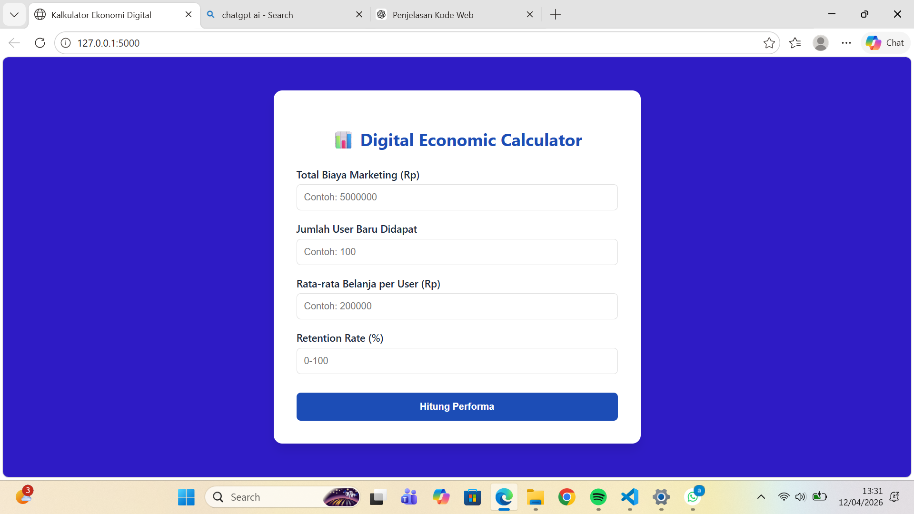

#Penjelasan kerangka kerja (framework/flow)
Pada project ini, saya menggunakan framework Flask yang berbasis Python untuk membangun sistem web yang saya buat.
Struktur project terdiri dari dua bagian utama, yaitu backend yang berada di file app.py, dan frontend yang berada di folder templates dengan file index.html.
Pada bagian backend, saya menggunakan file app.py yang dibangun dengan framework Flask.
Di awal, saya melakukan inisialisasi Flask untuk membuat aplikasi web.
Kemudian saya membuat route utama yang berfungsi untuk menampilkan halaman index.html sebagai tampilan awal. Selain itu, saya juga membuat route “/calculate” dengan metode POST untuk menerima data dari form yang diinput oleh user. Data tersebut kemudian saya ambil menggunakan request.form dan saya ubah menjadi tipe data numerik agar bisa dihitung. Selanjutnya, saya menerapkan logika perhitungan ekonomi digital, yaitu menghitung Customer Acquisition Cost dan Lifetime Value.
Saya juga menambahkan error handling untuk mencegah terjadinya error saat input tidak valid.
Lalu setelahnya, 
Pada bagian frontend, saya menggunakan file index.html sebagai tampilan utama website.
Di dalamnya terdapat struktur HTML yang terdiri dari head dan body. Pada bagian head, saya mengatur metadata dan judul halaman agar tampil dengan baik di berbagai perangkat. Saya juga menggunakan CSS untuk mengatur desain tampilan, seperti warna, font, dan posisi elemen agar terlihat rapi dan berada di tengah layar. Di bagian body, terdapat form yang digunakan untuk menerima input dari user. Form ini menggunakan metode POST dan diarahkan ke endpoint “/calculate” di backend.
Di dalam form terdapat beberapa input, seperti biaya marketing, jumlah customer, rata-rata pembelian, dan retention rate. Selain itu, terdapat tombol “Hitung Performa” yang berfungsi untuk mengirim data ke server dan memulai proses perhitungan, Index.html berfungsi sebagai antarmuka yang menghubungkan user dengan sistem backend.

#Penjelasan WEBSITE
nah ada pula output yang dihasilkan dari semua framework yang saya buat, tampilannya seperti ini
 
Website ini saya buat karena dalam dunia bisnis digital, penting untuk mengetahui apakah strategi marketing yang dilakukan sudah efektif atau belum.
Banyak pelaku usaha yang mengeluarkan biaya promosi, tetapi belum tentu mendapatkan hasil yang maksimal. Oleh karena itu, diperlukan alat sederhana untuk membantu melakukan analisis tersebut.
Pada website ini terdapat empat input utama.
Yang pertama adalah total biaya marketing, yaitu jumlah uang yang digunakan untuk promosi.
Yang kedua adalah jumlah user baru yang didapatkan dari hasil marketing tersebut.
Yang ketiga adalah rata-rata belanja per user, yaitu estimasi pengeluaran tiap pengguna.
Dan yang keempat adalah retention rate, yaitu persentase pengguna yang kembali menggunakan layanan.
Cara kerja website ini cukup sederhana. Pengguna hanya perlu memasukkan data ke dalam kolom yang tersedia, kemudian menekan tombol “Hitung Performa”.
Setelah itu, sistem akan mengolah data tersebut untuk menghasilkan informasi terkait performa bisnis, seperti estimasi pendapatan dan efisiensi biaya marketing.